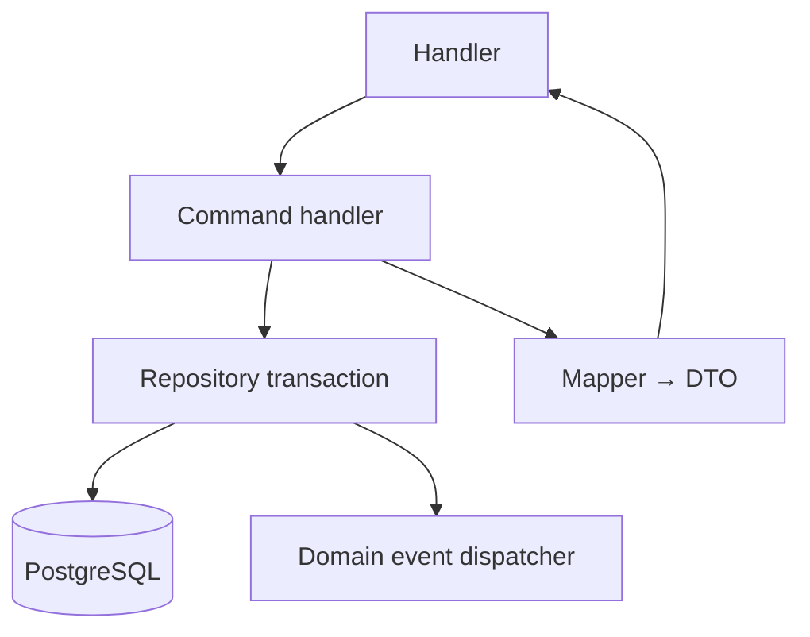
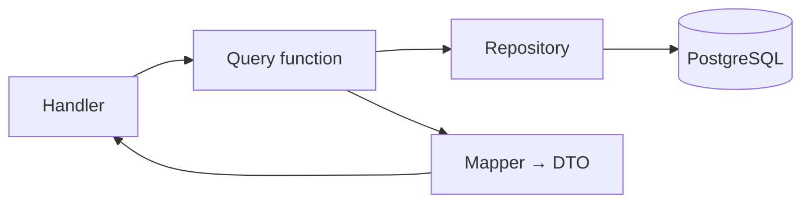

# Backend architecture

Code root: `backend/src/`. Postgres via Docker; TypeORM migrations + seed.

## Layer map

| Layer | Path | Job |
| --- | --- | --- |
| Handlers | `**/*.handlers.ts` | Wire CEF parser + handler exports |
| Commands | `vacation-request.commands.ts` | Create, approve, reject + rules |
| Queries | `vacation-request.queries.ts`, `team-planning/` | Lists, filters, pagination |
| Repository | `vacation-request.repository.ts` | DB reads/writes |
| Mapper | `*.mapper.ts` | snake_case entity → camelCase DTO |
| Schemas | `vacation-request.schemas.ts` | Zod (used in parsers) |
| Events | `vacation-request.events.ts` | Emit after successful commit |
| DB | `database/entities/`, `migrations/` | Schema + overlap constraint |
| Auth | `auth/auth.service.ts` | Login, bcrypt, JWT |

## Write path (command)



## Read path (query)



## Business rules (commands)

- `endDate > startDate`; start not in the past
- Approve/reject only while `PENDING`; rejection requires comment
- Overlap blocked for same user (`PENDING`/`APPROVED`) → HTTP 409 from DB constraint
- Approved rows are not updatable via a general PATCH

## Data contract

- Roles/status enums: uppercase (`REQUESTER`, `PENDING`, …)
- Dates: DB `date`, JSON `YYYY-MM-DD`
- Demo seed: `database/seed.ts` (password `demo1234`)

## Ops

```text
db:up → db:migrate → db:seed → npm run dev   # :8888, Swagger /doc
npm test                                      # needs migrated DB
npm run codegen                               # HandlerRegistry from root.yaml
```

Related: [middleware_architecture.plan.md](./middleware_architecture.plan.md).
