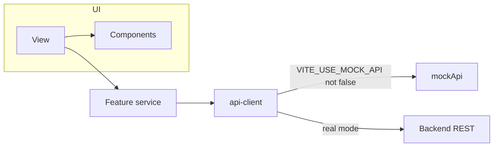
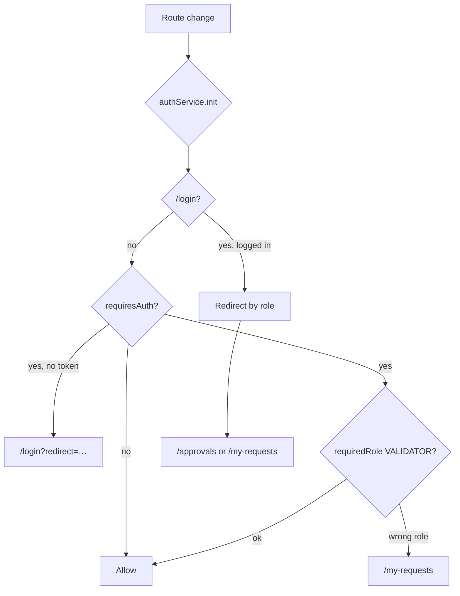

# Frontend architecture

Code root: `frontend/src/`. Dev server: repo root `vite.config.ts` (`@` → `frontend/src`).

## Layer map

| Layer | Path | Job |
| --- | --- | --- |
| Views | `features/*/views/` | Pages for each route |
| Components | `features/*/components/`, `components/` | UI + layout |
| Services | `features/*/*.service.ts` | Feature API calls (no Axios in views) |
| API client | `services/api-client.ts` | Mock switch, JWT, REST paths |
| Router | `router/index.ts`, `router/guards.ts` | Auth + validator-only routes |
| UX validation | `vacation-requests.validation.ts` | Hints only; server wins |
| Mock | `mocks/mock-api.ts`, `mock-data.ts` | Local demo state |

## Data flow

## Navigation flow

## Routes & features

| Route | Role | Feature folder |
| --- | --- | --- |
| `/login` | public | `auth` |
| `/my-requests` | authenticated | `vacation-requests` |
| `/approvals` | `VALIDATOR` | `approvals` |
| `/team-planning` | authenticated | `team-planning` |

Session: JWT in `localStorage` key `vacation_mgmt_auth_token`.

## Mock vs real

| Mode | Env | Behavior |
| --- | --- | --- |
| Mock (default) | `VITE_USE_MOCK_API` unset or ≠ `false` | `mockApi`; header demo switcher + reset |
| Real | `VITE_USE_MOCK_API=false` | Axios to `VITE_API_BASE_URL` (default `/api`); no mock fallback on error |

Related: [middleware_architecture.plan.md](./middleware_architecture.plan.md), [frontend_backend_integration_plan.plan.md](./frontend_backend_integration_plan.plan.md).
