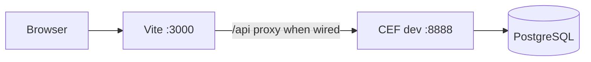
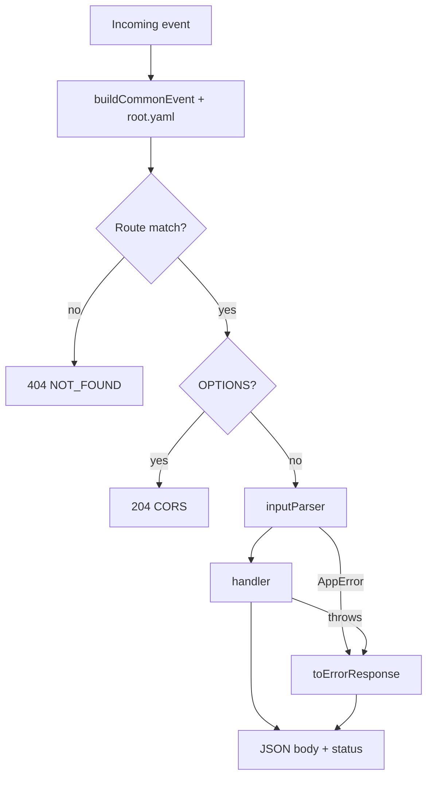
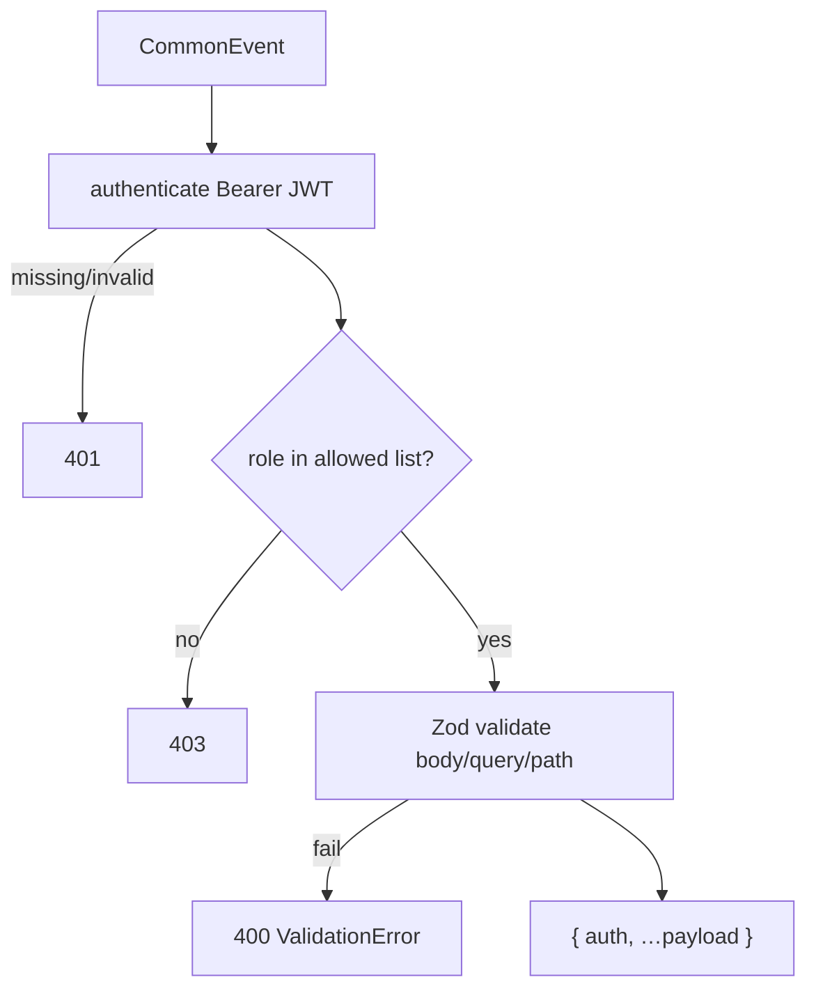
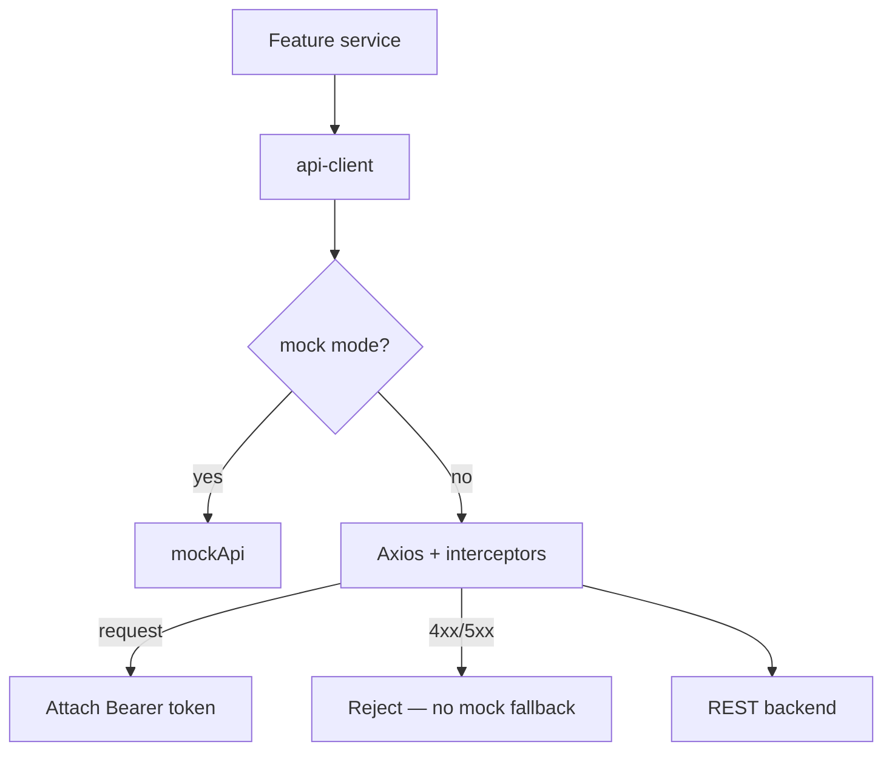

# Middleware architecture

Cross-cutting transport and auth — not vacation business rules (see [backend_architecture.plan.md](./backend_architecture.plan.md)).

## End-to-end (target local stack)

Until integration lands, frontend mock and backend API can run separately ([frontend_backend_integration_plan.plan.md](./frontend_backend_integration_plan.plan.md)).

## Server: CEF request pipeline

Entry: `backend/src/index.ts` (`handler` + `startDevServer`).

| Piece | File | Role |
| --- | --- | --- |
| Routes | `src/root.yaml` | Path, method, parser/handler refs |
| Registry | `generated/HandlerRegistry.ts` | Generated — do not hand-edit |
| Guard | `auth/auth.guard.ts` | `guarded(roles, read)` → JWT + RBAC |
| HTTP utils | `shared/http.ts` | Body, query, Zod `parseWith`, `HttpResult` |
| Errors | `shared/errors.ts` | `{ code, message, details? }` |

## Protected route parser

Public route: `POST /auth/login` (no `guarded` on parser).

## Client boundary

| Piece | File | Role |
| --- | --- | --- |
| HTTP client | `frontend/.../api-client.ts` | Mode switch, paths, token storage |
| UI guard | `router/guards.ts` | Redirects only — server enforces RBAC |

## Shared error shape

Both sides use `{ code, message, details? }`. Frontend: `getErrorMessage()` reads `message`.
