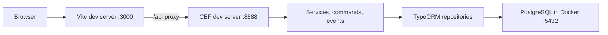

# Frontend-backend integration plan

## Current state (from reading `frontend/`)
- All HTTP access goes through one file, [`frontend/src/services/api-client.ts`](frontend/src/services/api-client.ts): Axios instance, `baseURL` from `VITE_API_BASE_URL` (default `/api`), bearer token from `localStorage`, and a `VITE_USE_MOCK_API` switch that **defaults to mock**.
- Feature services (`auth`, `approvals`, `team-planning`, `vacation-requests`) call only `authApiClient` / `vacationApiClient`, so the integration is mostly a single-file change on the frontend side.
- The frontend contract differs from the backend plan in ways the plan must resolve:

| Area | Frontend today | Backend plan |
|---|---|---|
| Paths | `/vacations/my`, `PUT /vacations/:id/approve`, `/team/planning?year&month`, `POST /auth/logout` | `/vacation-requests/me`, `PATCH .../approve`, `/team-planning?from&to` |
| Enums | `REQUESTER`, `VALIDATOR`, `PENDING`, `APPROVED`, `REJECTED` | Mixed case in the schema text |
| Request DTO | `requesterId`, `requesterName`, `validatorComment`, `daysCount`, `requesterDepartment`, `validatorName`, `decisionDate` | Schema has `user_id` and `comments`; no department, validator, or decision columns |
| User DTO | `department`, `totalVacationDays`, `usedVacationDays` | Not in the schema |
| Requester filter list | `mockApi.getAvailableUsers()` | No users endpoint |
| Login | Email only (`password` optional) | Email + password + JWT |

## Decisions
1. **Backend owns RESTful paths; the frontend client adapts.** Changing six URL strings in `api-client.ts` is cheaper than bending the API away from REST conventions.
   - `POST /auth/login`, `GET /auth/me`
   - `GET /vacation-requests/me`, `POST /vacation-requests`
   - `GET /vacation-requests?status=&userId=&search=&page=&pageSize=` (validator)
   - `PATCH /vacation-requests/:id/approve`, `PATCH /vacation-requests/:id/reject` with body `{ comment }`
   - `GET /users?role=REQUESTER` (validator only, feeds the requester filter)
   - `GET /team-planning?year=&month=` (both roles; keep the frontend's `TeamPlanningData` shape because the calendar already renders it)
   - No logout endpoint: JWT is stateless, so the frontend just drops the token.
2. **Uppercase enum values end to end** (`REQUESTER`, `PENDING`, ...) in the PostgreSQL enums, API, and frontend. This removes all mapping code.
3. **Database stays snake_case and the API stays camelCase.** One mapper per entity in the backend (`toVacationRequestDto`, `toUserDto`) is the only translation point.
4. **Stick to the assignment schema; trim the frontend extras.**
   - API request DTO: `id, requesterId, requesterName, requesterEmail, startDate, endDate, daysCount, reason, status, comments, createdAt, updatedAt`. `requesterName` and `requesterEmail` come from a join, and `daysCount` is computed.
   - Rename frontend `validatorComment` to `comments`. Make `requesterDepartment`, `validatorId`, `validatorName`, `decisionDate`, `department`, `totalVacationDays`, and `usedVacationDays` optional, or remove them where the UI does not need them. Do not add database columns the brief did not ask for.
5. **One error shape**, matching the existing frontend `ApiError`: `{ code, message, details? }`. [`getErrorMessage`](frontend/src/utils/error.utils.ts) already reads `message`, so the UI needs no change. Use `details` for field-level validation errors.
6. **Dates are `YYYY-MM-DD` strings in both directions** (PostgreSQL `date`), matching `date.utils.ts`. Do not convert them to `Date` across the wire.
7. **No shared types package** (YAGNI). The frontend types are the contract, and a backend contract test asserts the DTO keys.

## Local dev wiring
- CEF dev server: `ts-node src/index.ts --local --port 8888`, run from [`backend/`](backend/).
- Vite proxy in [`frontend/vite.config.ts`](frontend/vite.config.ts): `/api` to `http://localhost:8888`, stripping the `/api` prefix. The browser stays same-origin, so local development needs no CORS configuration. CEF's `Response` CORS headers still cover non-proxied use.
- [`frontend/.env.example`](frontend/.env.example): `VITE_API_BASE_URL=/api`, `VITE_USE_MOCK_API=false`. Flip the code default to **real API** now that a backend exists; mock mode stays explicit opt-in.
- [`backend/.env.example`](backend/.env.example): `DATABASE_URL`, `JWT_SECRET`, `JWT_EXPIRES_IN`, `PORT=8888`.
- Root [`package.json`](package.json): add `backend` to `workspaces`; replace the stale root `vite` scripts with `dev:frontend`, `dev:backend`, `db:up`, `db:migrate`, `db:seed`, `typecheck`, and `build`, delegating with `-w`. Run the two dev servers in two terminals instead of adding `concurrently`.

## Frontend changes (minimal, real mode only)
- [`api-client.ts`](frontend/src/services/api-client.ts): new paths and verbs, a `getRequesters()` call, and no logout HTTP call. Add a response interceptor that, on **401**, clears the token and redirects to `/login?redirect=...`. The client must still never fall back to mock silently.
- [`auth.service.ts`](frontend/src/features/auth/auth.service.ts) `init()`: if there is no token, return `null` without calling `/auth/me`. The mock currently auto-logs in the first user, and real mode must not.
- [`LoginView.vue`](frontend/src/features/auth/views/LoginView.vue): add a required password field. The demo-account buttons prefill email and the seeded demo password. Make `password` required in `LoginCredentials`.
- [`ApprovalFilters.vue`](frontend/src/features/approvals/components/ApprovalFilters.vue): load requesters through the service (`GET /users`) instead of `mockApi`, and send `userId` instead of `requesterId`.
- [`AppHeader.vue`](frontend/src/components/layout/AppHeader.vue) and [`AppLayout.vue`](frontend/src/components/layout/AppLayout.vue): render the demo user switcher and "reset mock data" only when `isMockMode` is true.
- Keep client-side validation for usability. The backend independently enforces every rule.

## Backend requirements this adds to the backend plan
- Paths, enum casing, DTO mappers, and the `/users` and `/team-planning?year&month` endpoints listed above.
- Seed users that match the frontend demo accounts (same emails and names), plus a few requests, so both modes look the same.
- Status codes the UI already handles through `message`: 400 validation, 401 missing or expired token, 403 wrong role, 404 not found, 409 overlap or request not pending.

## Verification
- Backend: Node test runner contract test for DTO keys and the error shape, plus the business-rule tests from the backend plan.
- Manual end to end with `VITE_USE_MOCK_API=false`:
  - Requester: logs in, creates a request, gets a 409 message for an overlap and a message for a past date, sees it Pending, and is redirected away from `/approvals`.
  - Validator: sees all requests, filters by status and user, paginates, approves one, and must enter a comment before rejecting another.
  - Expired or removed token: redirected to login.
- Run `npm run typecheck` and `npm run build` for both workspaces before committing.
- README: two-terminal run instructions, mock versus real mode, and demo credentials.

## Sequence
1. Build the backend to the contract above, following the backend plan.
2. Add the proxy, env files, and root scripts.
3. Apply the frontend changes and switch to real mode.
4. Run the end-to-end checks and update the README.
