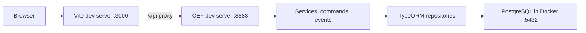

# Frontend-backend integration plan

## Current state
- **The backend is already built to the contract below** (`backend/src/root.yaml`, mappers, seed with the frontend demo emails and password `demo1234`). The remaining work is dev wiring and the frontend switch.
- **The frontend runs from the repo root**: root [`vite.config.ts`](vite.config.ts) and root [`index.html`](index.html) (which loads `/frontend/src/main.ts`). `frontend/` has no `index.html`, so `frontend/vite.config.ts` is not used by `npm run dev`.

### Frontend (from reading `frontend/`)
- All HTTP access goes through one file, [`frontend/src/services/api-client.ts`](frontend/src/services/api-client.ts): Axios instance, `baseURL` from `VITE_API_BASE_URL` (default `/api`), bearer token from `localStorage`, and a `VITE_USE_MOCK_API` switch that **defaults to mock**.
- Feature services (`auth`, `approvals`, `team-planning`, `vacation-requests`) call only `authApiClient` / `vacationApiClient`, so the integration is mostly a single-file change on the frontend side.
- The frontend contract differs from the backend plan in ways the plan must resolve:

| Area | Frontend today | Backend plan |
|---|---|---|
| Paths | `/vacations/my`, `PUT /vacations/:id/approve`, `/team/planning?year&month`, `POST /auth/logout` | `/vacation-requests/me`, `PATCH .../approve`, `/team-planning?year&month`, no logout |
| List filters | `requesterId` (default `'ALL'`), `searchTerm` | `userId` (UUID, rejects `'ALL'` with 400), `search` |
| Enums | `REQUESTER`, `VALIDATOR`, `PENDING`, `APPROVED`, `REJECTED` | Mixed case in the schema text |
| Request DTO | `requesterId`, `requesterName`, `validatorComment`, `daysCount`, `requesterDepartment`, `validatorName`, `decisionDate` | Schema has `user_id` and `comments`; no department, validator, or decision columns |
| User DTO | `department`, `totalVacationDays`, `usedVacationDays` | Not in the schema |
| Requester filter list | `mockApi.getAvailableUsers()` | No users endpoint |
| Login | Email only (`password` optional) | Email + password + JWT |

## Decisions
1. **Backend owns RESTful paths; the frontend client adapts.** Changing six URL strings in `api-client.ts` is cheaper than bending the API away from REST conventions.
   - `POST /auth/login`, `GET /auth/me`
   - `GET /vacation-requests/me`, `POST /vacation-requests`
   - `GET /vacation-requests?status=&userId=&search=&page=&pageSize=` (validator)
   - `PATCH /vacation-requests/:id/approve`, `PATCH /vacation-requests/:id/reject` with body `{ comment }`
   - `GET /users?role=REQUESTER` (validator only, feeds the requester filter)
   - `GET /team-planning?year=&month=` (both roles; keep the frontend's `TeamPlanningData` shape because the calendar already renders it)
   - No logout endpoint: JWT is stateless, so the frontend just drops the token.
2. **Uppercase enum values end to end** (`REQUESTER`, `PENDING`, ...) in the PostgreSQL enums, API, and frontend. This removes all mapping code.
3. **Database stays snake_case and the API stays camelCase.** One mapper per entity in the backend (`toVacationRequestDto`, `toUserDto`) is the only translation point.
4. **Stick to the assignment schema; trim the frontend extras.**
   - API request DTO: `id, requesterId, requesterName, requesterEmail, startDate, endDate, daysCount, reason, status, comments, createdAt, updatedAt`. `requesterName` and `requesterEmail` come from a join, and `daysCount` is computed.
   - Rename frontend `validatorComment` to `comments`. Make `requesterDepartment`, `validatorId`, `validatorName`, `decisionDate`, `department`, `totalVacationDays`, and `usedVacationDays` optional, or remove them where the UI does not need them. Do not add database columns the brief did not ask for.
5. **One error shape**, matching the existing frontend `ApiError`: `{ code, message, details? }`. [`getErrorMessage`](frontend/src/utils/error.utils.ts) already reads `message`, and the views that call it (login, request form, approvals dashboard) need no change. The four services (`auth`, `approvals`, `vacation-requests`, `team-planning`) store `err.message` instead, which is Axios's "Request failed with status code N"; switch them to `getErrorMessage(err)`. Use `details` for field-level validation errors.
6. **Dates are `YYYY-MM-DD` strings in both directions** (PostgreSQL `date`), matching `date.utils.ts`. Do not convert them to `Date` across the wire.
7. **No shared types package** (YAGNI). The frontend types are the contract, and a backend contract test asserts the DTO keys.

## Local dev wiring
- CEF dev server: `npm run dev` in [`backend/`](backend/) (`ts-node src/index.ts --local 8888`). CEF reads the port from the bare argument after `--local` (`process.argv[3]`, default 8888); there is no `--port` flag and no `PORT` env.
- Vite proxy in the **root** [`vite.config.ts`](vite.config.ts) (the config that actually runs): `/api` to `http://localhost:8888`, stripping the `/api` prefix because backend routes have none. The browser stays same-origin, so local development needs no CORS configuration. CEF's `Response` CORS headers (`FRONT_END_URL`) still cover non-proxied use. Delete the unused `frontend/vite.config.ts` so there is one config. ponytail: moving `index.html` into `frontend/` to make it a standalone Vite app is the upgrade path if the frontend ever needs to build on its own.
- Root `.env.example` (Vite loads env from the root): `VITE_API_BASE_URL=/api`, `VITE_USE_MOCK_API=false`. Flip the code default to **real API** now that a backend exists; mock mode stays explicit opt-in.
- [`backend/.env.example`](backend/.env.example) already exists: `DATABASE_URL`, `JWT_SECRET`, `JWT_EXPIRES_IN`, `FRONT_END_URL`. No changes needed.
- Root [`package.json`](package.json): add `backend` to `workspaces`, delete the stale `backend/package-lock.json`, and reinstall from the root. Keep the root `vite` scripts for the frontend (renaming `dev` to `dev:frontend`) and add `dev:backend`, `db:up`, `db:migrate`, `db:seed`, and `test:backend`, delegating with `-w backend`. Run the two dev servers in two terminals instead of adding `concurrently`.

## Frontend changes (minimal, real mode only)
- [`api-client.ts`](frontend/src/services/api-client.ts):
  - New paths and verbs (`PATCH` for approve and reject), a `getRequesters()` call, and no logout HTTP call. The client must still never fall back to mock silently.
  - `getAllRequests` maps the frontend filters to backend query params in one place: `requesterId` to `userId` and `searchTerm` to `search`, dropping `'ALL'` and empty strings (`status: 'ALL'` is accepted by the backend and can pass through). Without this the default filters return 400.
  - Response interceptor: on **401**, clear the token and redirect to `/login?redirect=...`, **except** for `/auth/login` (a wrong password must show "Invalid email or password", not redirect) and `/auth/me` (`authGuard` calls `init()` mid-navigation and already handles the failure).
- [`auth.service.ts`](frontend/src/features/auth/auth.service.ts) `init()`: if there is no token, return `null` without calling `/auth/me`. The mock currently auto-logs in the first user, and real mode must not. On a 401 from `/auth/me`, clear the stale token.
- [`LoginView.vue`](frontend/src/features/auth/views/LoginView.vue): add a required password field. The demo-account buttons prefill email and the seeded demo password (`demo1234`). Make `password` required in `LoginCredentials`.
- [`ApprovalFilters.vue`](frontend/src/features/approvals/components/ApprovalFilters.vue): load requesters through the service (`GET /users?role=REQUESTER`) instead of `mockApi`.
- [`AppHeader.vue`](frontend/src/components/layout/AppHeader.vue) and [`AppLayout.vue`](frontend/src/components/layout/AppLayout.vue): render the demo user switcher and "reset mock data" only when `isMockMode` is true.
- Fields the backend does not return, which the UI currently renders. Guard each with `v-if` or remove it, not just mark it optional in the types:
  - `user.department` in `ApprovalFilters.vue` (would render "Name ()") and `TeamPlanningView.vue`.
  - `requesterDepartment` in `ApprovalDashboardView.vue` and `RejectionDialog.vue`.
  - `validatorName` in `VacationRequestList.vue` ("Decision recorded by").
  - `totalVacationDays` in `vacation-requests.service.ts` already falls back to 25; keep that.
- Rename `validatorComment` to `comments` in the type, the mock data and mock API, `VacationRequestList.vue`, and `ApprovalDashboardView.vue`.
- Services (`auth`, `approvals`, `vacation-requests`, `team-planning`): replace `err instanceof Error ? err.message : ...` with `getErrorMessage(err)` so stored errors show the backend message.
- Keep client-side validation for usability. The backend independently enforces every rule.

## Backend requirements (already implemented, verify only)
- Paths, enum casing, DTO mappers, and the `/users` and `/team-planning?year&month` endpoints listed above.
- Seed users that match the frontend demo accounts (same emails and names), plus a few requests, so both modes look the same.
- Status codes the UI already handles through `message`: 400 validation, 401 missing or expired token, 403 wrong role, 404 not found, 409 overlap or request not pending.

## Verification
- Backend: Node test runner contract test for DTO keys and the error shape, plus the business-rule tests from the backend plan.
- Manual end to end with `VITE_USE_MOCK_API=false`:
  - Login with a wrong password shows the backend message and stays on `/login`.
  - Requester: logs in, creates a request, gets a 409 message for an overlap and a message for a past date, sees it Pending, and is redirected away from `/approvals`.
  - Validator: sees all requests with the default filters (no 400), filters by status, user, and search, paginates, approves one, and must enter a comment before rejecting another.
  - Expired or removed token: redirected to login.
- Run `npm run typecheck` and `npm run build` for both workspaces before committing.
- README: two-terminal run instructions, mock versus real mode, and demo credentials (`demo1234`). Remove `frontend/vite.config.ts` from the project tree.

## Sequence
1. ~~Build the backend to the contract above~~ (done). Run `npm test -w backend` against Docker PostgreSQL to confirm it still passes.
2. Add the proxy to the root `vite.config.ts`, the root `.env.example`, and the root scripts and workspace.
3. Apply the frontend changes and switch to real mode.
4. Run the end-to-end checks and update the README.
