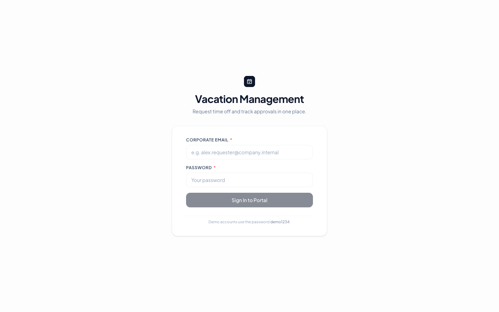
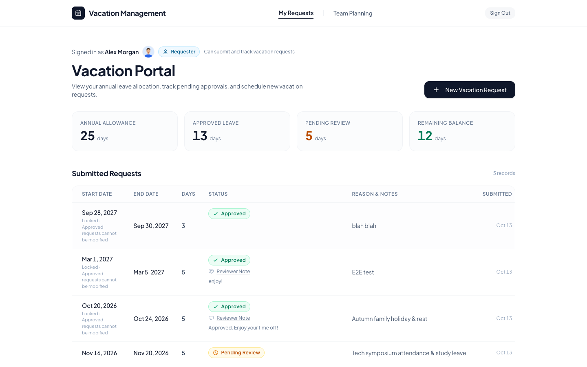
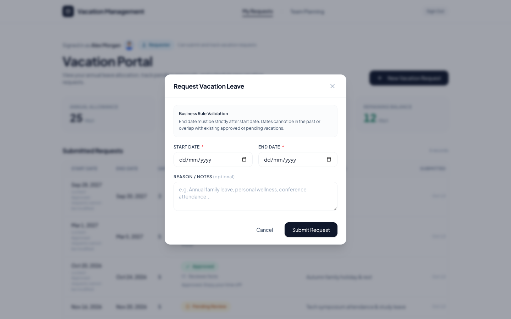
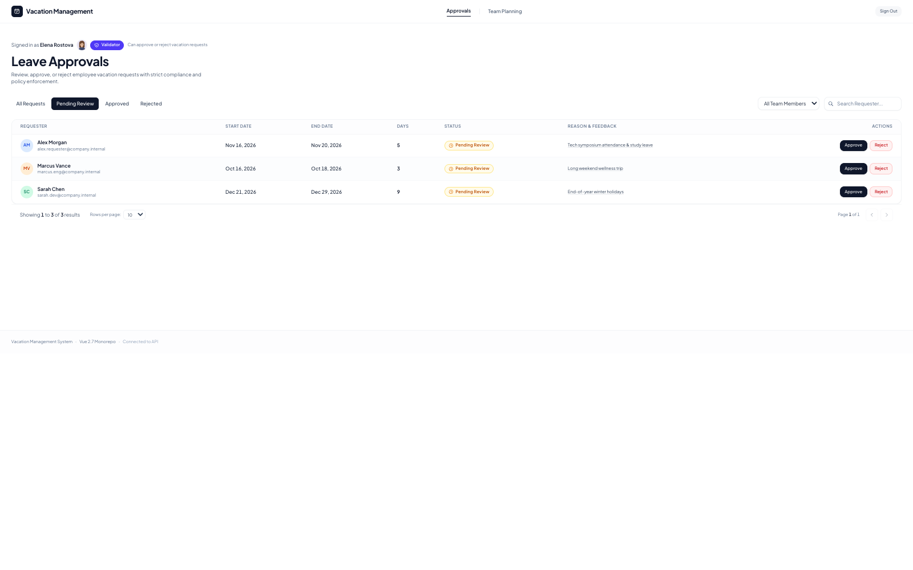
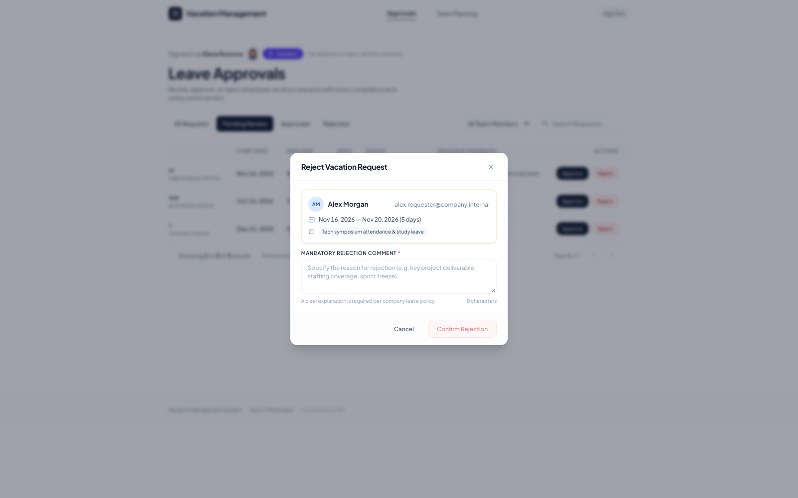
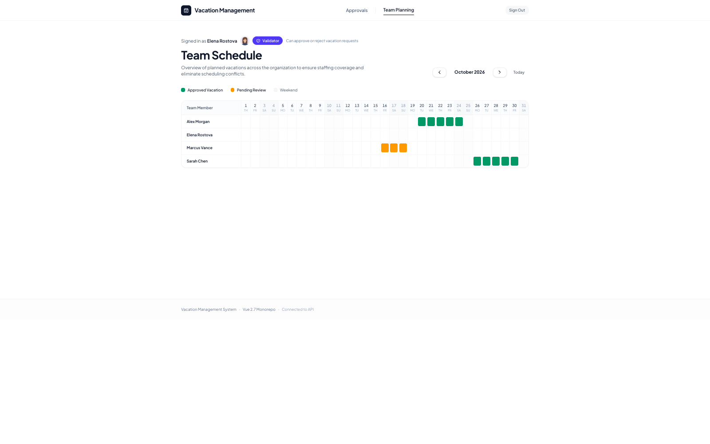

# Vacation Management

Solution for the **Web Development Recruitment Test: Vacation Management Interface**. Requesters submit vacation requests; validators approve or reject them.

- **Frontend:** Vue 2.7, strict TypeScript, Vue Router 3, Axios, Tailwind CSS (`frontend/`)
- **Backend:** Node.js, Common Event Framework (CEF), TypeORM, PostgreSQL in Docker (`backend/`, see [`backend/README.md`](backend/README.md))

---

## 1. Architecture & Repository Structure

An npm workspace monorepo. Vite serves the Vue frontend from the repo root.

In local development, the browser talks only to port `3000`. Vite forwards `/api` to the backend on port `8888` and strips the `/api` prefix, because backend routes have no such prefix. That keeps requests same-origin and avoids a local CORS setup.

### Frontend Architecture

The frontend follows a feature-based architecture. Authentication, vacation requests, approvals, and team planning each own their views, components, services, types, and validation logic. Shared UI, routing, API access, and utilities stay outside the feature folders.

```text
frontend/
├── src/
│   ├── assets/                    # Fonts, styles, avatars
│   ├── components/
│   │   ├── common/                # Buttons, inputs, dialogs, tables
│   │   └── layout/                # Header, sidebar, identity display
│   ├── features/
│   │   ├── auth/
│   │   │   ├── views/
│   │   │   └── auth.service.ts
│   │   ├── vacation-requests/
│   │   │   ├── components/
│   │   │   ├── views/
│   │   │   ├── vacation-requests.service.ts
│   │   │   └── vacation-requests.validation.ts
│   │   ├── approvals/
│   │   │   ├── components/
│   │   │   ├── views/
│   │   │   └── approvals.service.ts
│   │   └── team-planning/
│   │       ├── views/
│   │       └── team-planning.service.ts
│   ├── router/                    # Routes and role guards
│   ├── services/                  # Axios API client and contracts
│   ├── mocks/                     # Optional browser mock API
│   ├── types/
│   └── utils/
└── tests/
```

### Backend Architecture

The backend follows a layered architecture: CEF routes and guards handle HTTP, handlers and commands/queries hold application logic, repositories handle persistence, and TypeORM talks to PostgreSQL. See [`backend/README.md`](backend/README.md) for API and database details.

```text
backend/
├── src/
│   ├── auth/                      # Login, JWT service and guards
│   ├── vacation-requests/
│   │   ├── vacation-request.handlers.ts
│   │   ├── vacation-request.commands.ts
│   │   ├── vacation-request.queries.ts
│   │   ├── vacation-request.repository.ts
│   │   ├── vacation-request.schemas.ts
│   │   └── vacation-request.events.ts
│   ├── team-planning/             # Team schedule query handler
│   ├── users/                     # User listing and mapping
│   ├── database/
│   │   ├── entities/
│   │   ├── migrations/
│   │   ├── migrate.ts
│   │   └── seed.ts
│   ├── shared/                    # Dates, events, errors and HTTP
│   ├── config/
│   ├── root.yaml                  # OpenAPI routes and CEF handlers
│   └── index.ts
├── test/
├── docker-compose.yml
└── README.md
```

### Request Flow

```text
Vue view
  → feature service
  → shared Axios client
  → Vite /api proxy
  → CEF route and auth guard
  → handler
  → command or query
  → TypeORM repository
  → PostgreSQL
```

### Root Files

```text
vacation-management/
├── frontend/
├── backend/
├── slide-screenshots/
├── index.html
├── vite.config.ts
├── .env.example
├── package.json
└── README.md
```

### Reviewer and Developer Resources

Developers evaluating this repository can use:

- [Project-specific assets](.cursor/project_specific_assets/) for requirements, architecture plans, integration notes, and the release workflow.
- [Architecture plans](.cursor/project_specific_assets/Architechture_And_System_Design/) for the frontend, backend, and middleware decisions.
- [Personas](.cursor/personas/) for role-specific guidance: frontend, backend, QA, release, and the technical demo.

---

## 2. Installation & Running Locally

> [!TIP]
> **Recommended for evaluators:** Use the [Technical Demo Guide](.cursor/personas/technical-demo-guide.md) for quick setup and an evidence-based walkthrough of the application.

Prerequisites: **Node.js 20+**, **npm 9+**, and **Docker** (PostgreSQL runs in a container).

```bash
git clone <repo-url>
cd vacation-management
npm install                             # root + both workspaces

cp backend/.env.example backend/.env    # set JWT_SECRET to a random 32+ character string
npm run db:up                           # PostgreSQL 16 on localhost:5432
npm run db:migrate                      # schema, enums, constraints
npm run db:seed                         # demo users + sample requests (idempotent)
```

Then start both apps in two terminals:

```bash
npm run dev:backend                     # API on http://localhost:8888, Swagger UI at /doc
npm run dev:frontend                    # App on http://localhost:3000
```

Open http://localhost:3000. The frontend calls `/api`, which Vite proxies to the backend.

Other scripts:

| Script | Purpose |
| --- | --- |
| `npm run typecheck` | Type-check frontend and backend |
| `npm run test:backend` | Backend unit + DB-backed API tests (needs `db:up` + `db:migrate`) |
| `npm run build` | Production build of the frontend |
| `npm run build -w backend` | Bundle the backend (`backend/dist/index.js`, Lambda-ready) |

**Mock mode (no backend):** set `VITE_USE_MOCK_API=true` in a root `.env` (see [`.env.example`](.env.example)). The UI then uses an in-browser mock stored in `localStorage`, accepts any password, and shows a "Reset Demo Data" link in the footer. The default is real API mode.

A step-by-step test walkthrough for both roles is in [`MANUAL_TESTING.md`](.cursor/project_specific_assets/MANUAL_TESTING.md).

---

## 3. Seeded Demo Accounts

All accounts use the password **`demo1234`**.

| Role | Name | Email |
| :--- | :--- | :--- |
| **REQUESTER** | Alex Morgan | `alex.requester@company.internal` |
| **REQUESTER** | Sarah Chen | `sarah.dev@company.internal` |
| **REQUESTER** | Marcus Vance | `marcus.eng@company.internal` |
| **VALIDATOR** | Elena Rostova | `elena.validator@company.internal` |

---

## 4. Running Application

### Sign in



### Requester portal





### Validator portal







---

## 5. Business Rules Implemented

Each rule is checked in the UI for instant feedback and enforced again by the backend (server-side details in [`backend/README.md`](backend/README.md#architecture)):

1. **End date after start date:** `endDate > startDate`.
2. **No overlapping requests:** a user's requests cannot overlap their `PENDING` or `APPROVED` requests. Rejected requests free their dates.
3. **Approved requests are immutable:** no edit or re-decision once `APPROVED`.
4. **No past start dates:** the start date cannot be before today.
5. **Rejection requires a comment:** a non-empty comment is mandatory.
6. **Only validators decide:** approvals routes and actions are limited to the `VALIDATOR` role (router guards in the UI, JWT role checks on the API).

---

## 6. Technical Decisions

1. **Vue 2.7 + strict TypeScript:** Vue 2.7.16 with `strict: true`; no Vue 3-only syntax (`<script setup>`, `defineProps`) or Vue Router 4.
2. **Single API client:** all HTTP goes through [`api-client.ts`](frontend/src/services/api-client.ts) (Axios, bearer token, 401 redirect to login). `VITE_USE_MOCK_API` switches explicitly to the mock adapter; it never silently falls back on errors.
3. **Feature-based folders:** `features/auth`, `vacation-requests`, `approvals`, `team-planning`, keeping data fetching out of presentational components.
4. **Timezone-safe dates:** `YYYY-MM-DD` strings are parsed as integer year/month/day on both sides, avoiding UTC off-by-one shifts.
5. **Backend:** commands and domain events, overlap protection via a PostgreSQL exclusion constraint, and atomic status transitions. See [`backend/README.md`](backend/README.md#architecture).
6. **Minimal design:** neutral greys, typographic section labels, unboxed status text, and a small role pill for the signed-in user.

---

## 7. Known Limitations

- Department and vacation-balance fields exist only in mock mode; the API user has `id`, `name`, `email`, and `role`.
- Backend limitations (in-process events, server-timezone "today", stateless JWT without refresh or rate limiting, unscoped team planning) are listed in [`backend/README.md`](backend/README.md#known-limitations).
